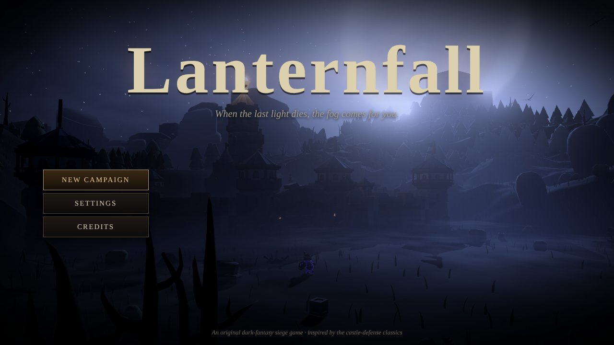
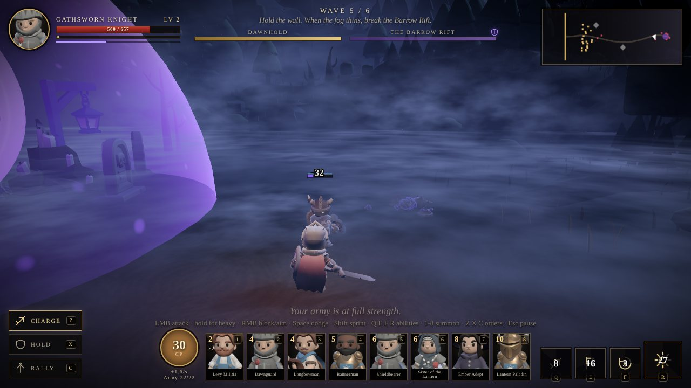
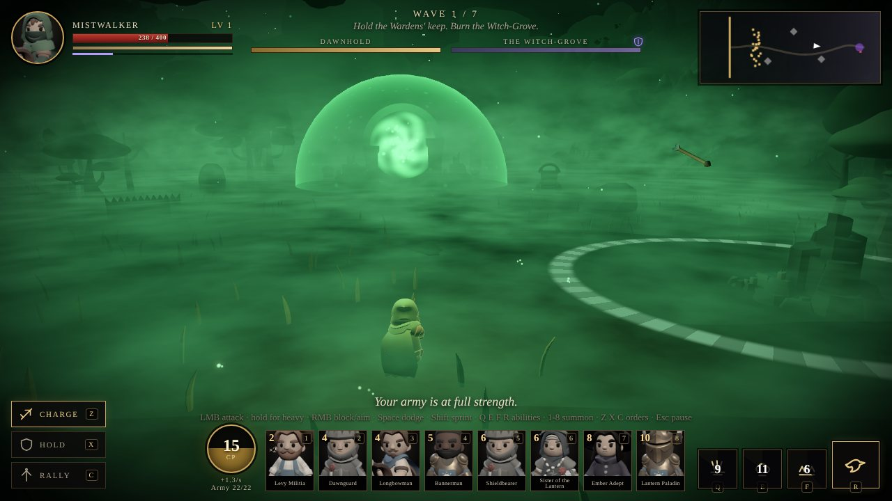
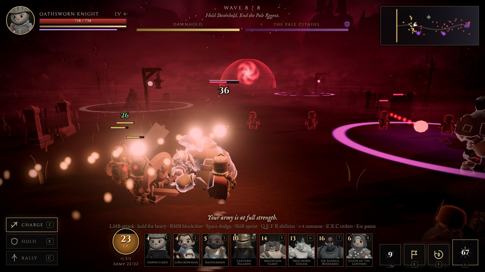
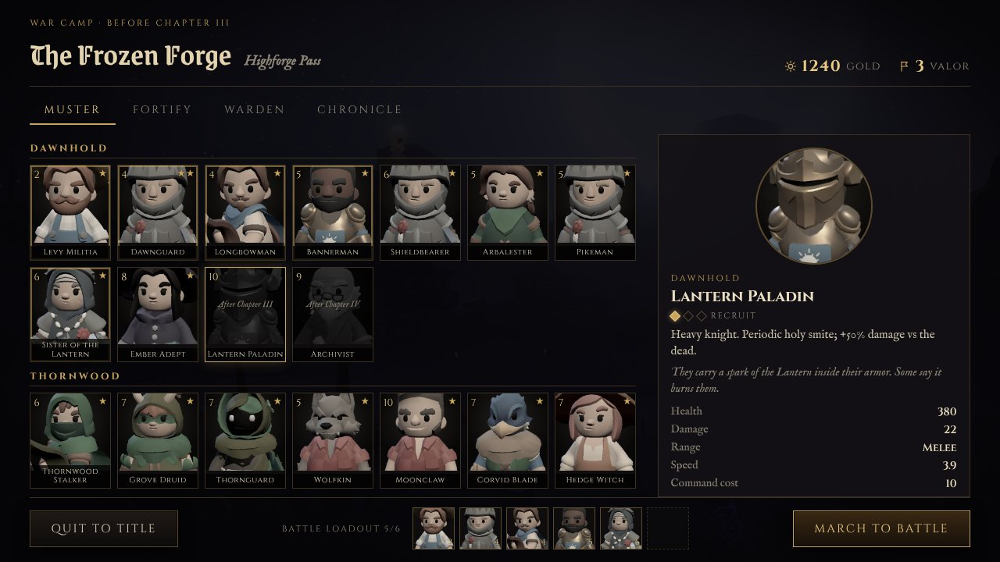

# Lanternfall

*When the last light dies, the fog comes for you.*

A dark-fantasy castle-defense action game that runs in the browser. You are the commander: you lead from the field outside your fortress and spend coin from your war chest to call soldiers out of the gate, who march and fight in formation. The Hollow walk out of the fog in waves. Hold the wall, rekindle the Lantern Shrines, break the last wave, then storm the enemy stronghold before your Lantern goes out.

Built with three.js. No game engine, no server: it's a static site.



| | |
|---|---|
|  |  |
|  |  |

## What's in it

- **Campaign:** 6 chapters with branching choices and two endings. Each chapter has its own map, weather, monsters, boss and enemy stronghold.
- **4 hero classes:** Oathsworn Knight, Mistwalker, Lanternmage and Wolf of the North. The hero attacks on its own; each class has 4 one-tap spells that find their own targets and can be upgraded with talents.
- **36 allies to call in** across 5 factions (Dawnhold, Thornwood, Highforge, Red Maw, Wanderers). The roster includes militia, bannermen, clerics, paladins, druids, wolfkin, clockwork sentinels, mountain giants, frost golems, catapults and dwarven bombards. Some are unlocked only by story choices.
- **21 enemy types and 6 bosses:** the Hollow (skeleton legions, hexers, bonecallers, bone colossi), blighted werewolves, fen witches, maddened orcs, dreadguard, abominations, and the Pale Regent.
- **Formations:** called-in units take a slot in ranks (shields in front, swords and spears behind, archers and casters further back, healers and siege at the rear). The army marches as a block to rekindle shrines, wheels to face the horde, holds the line when it makes contact and falls back to stay between the enemy and the castle.
- **Siege systems:** a coin war chest, Bannermen, capturable Lantern Shrines, arrow towers, engineers that build turrets, castle upgrades and unit veterancy.
- **Look and sound:** moonlit height fog that thickens toward the enemy, rolling fog banks, lightning, crows, rim-lit monsters, bloom and ambient occlusion. The score is synthesized live (drones, war drums, choir, funeral bells, war horns).

## Controls

| | |
|---|---|
| Move | Click the ground (WASD also works) |
| Attack | Automatic; click an enemy to pick your target |
| Spells | Q E F R, one tap each |
| Call support | 1–8 or click a card (costs coin) |
| Zoom | Mouse wheel |
| Pause | Esc |

On touch devices, tap where you'd click.

## Run it locally

```bash
npm install
npm run dev        # http://localhost:8080
```

`npm run build` bundles `src/` into `public/game.js`. Everything the game needs lives in `public/`.

## Deploy to Vercel

1. Import this repo in Vercel (**Add New → Project**).
2. Leave the defaults. `vercel.json` already sets the build command (`npm run build`) and the output folder (`public`).
3. Deploy. Every push to `main` redeploys.

## Project layout

```
public/            static site: index.html, game.js (built), assets/, fonts/, licenses/
src/main.js        boot, game loop, campaign flow
src/core/          renderer + post FX, asset loader, materials (fog/grim shader patch), audio, input
src/world/         sky, terrain, biomes, level builder, atmosphere (fog banks, crows, lightning), particles
src/game/          units + AI, hero, battle manager, projectiles, camera, saves, data (units, campaign)
src/ui/            HUD, dialogue scenes, menus
tools/             asset pipeline (fetch + optimize the CC0 packs), screenshot test scripts
```

### Rebuilding the 3D assets (optional)

The optimized models in `public/assets/` are committed, so you don't need this to play or deploy.

```bash
npm run assets:fetch    # sparse-clones the CC0 packs into ./vendor
npm run assets          # optimizes characters, animations, props and environments with glTF-Transform
bash tools/convert-sfx.sh   # converts the Kenney sounds (needs ffmpeg)
```

## Credits

- Characters, animations, castles, forests and graveyard pieces: **Kay Lousberg (KayKit)**, CC0.
- Foley and UI sounds: **Kenney**, CC0.
- Fonts: Grenze Gotisch, Cinzel, IM Fell English (SIL Open Font License).
- Libraries: three.js, N8AO, postprocessing, meshoptimizer, glTF-Transform.

Asset licenses are in `public/licenses/`.
